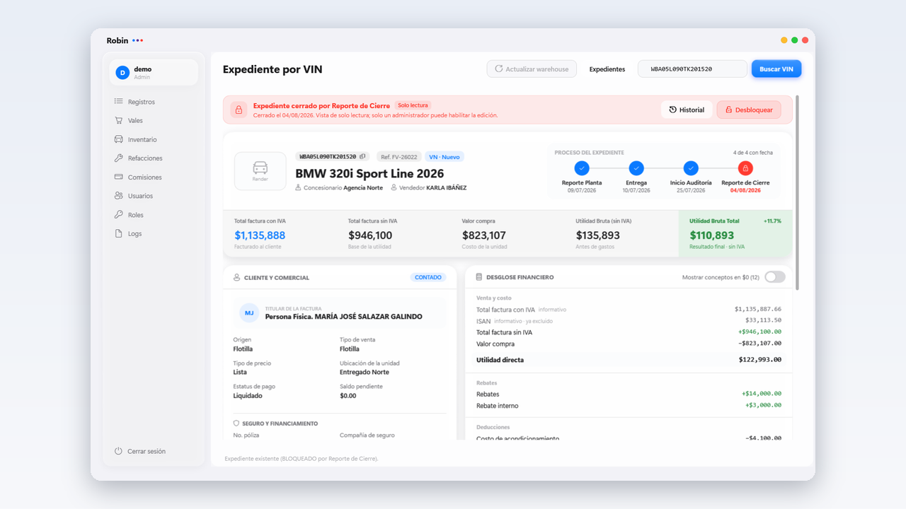
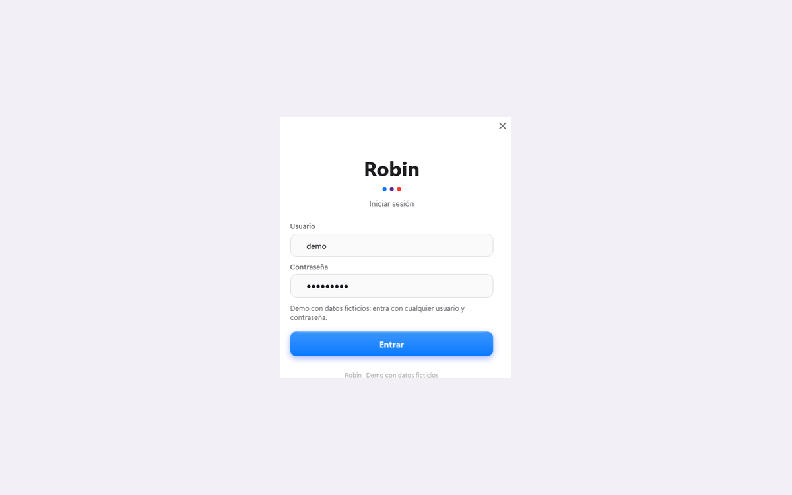
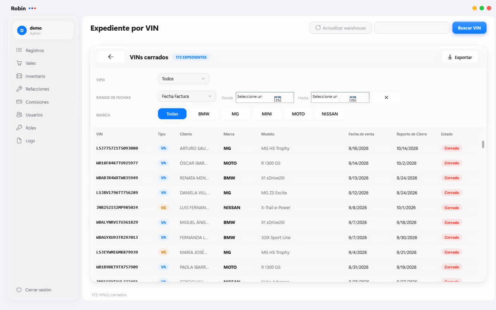
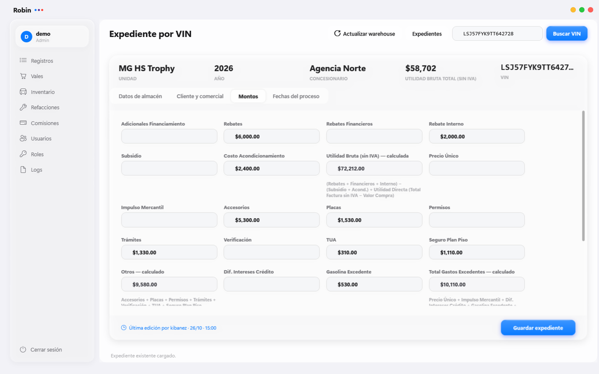
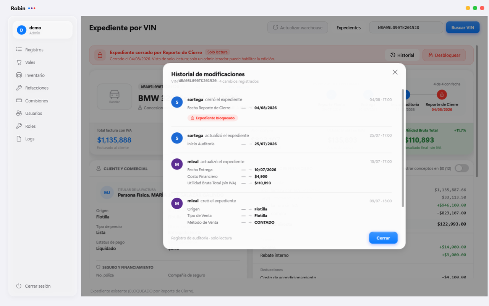
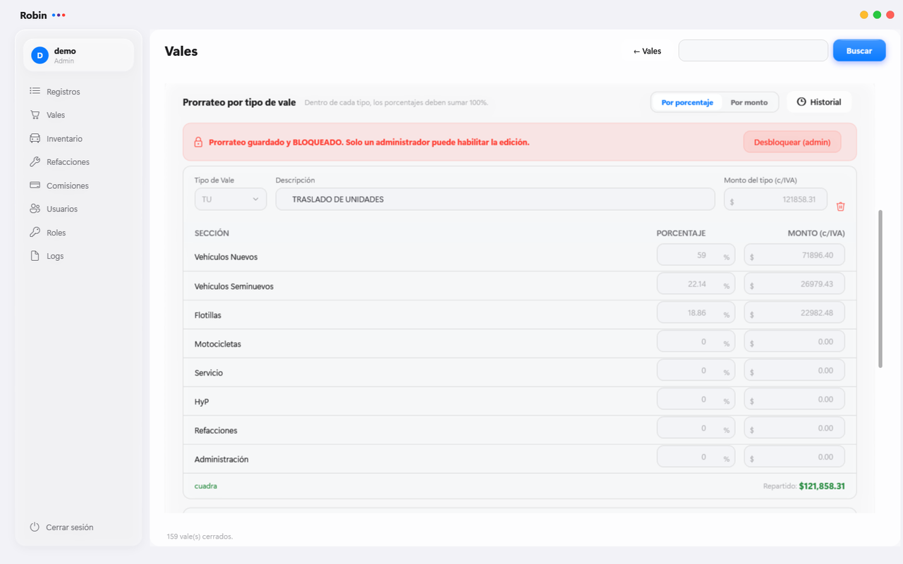
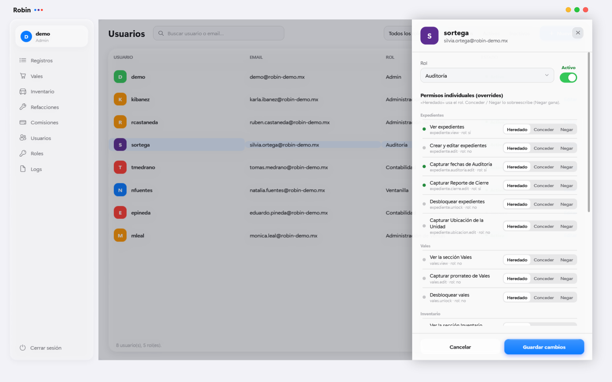
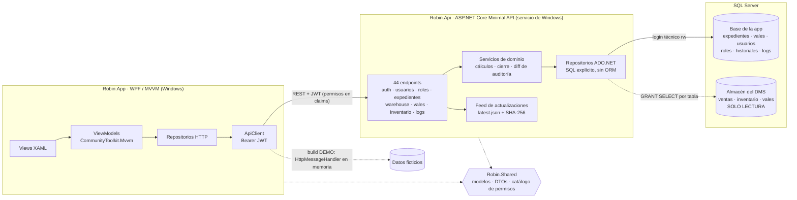

<div align="center">
  
  <h1>Robin</h1>
  <p><b>App de escritorio que lleva el expediente de cada unidad vendida (por VIN) y el prorrateo de gastos de una red de concesionarios, montada encima del almacén del DMS sin escribir en él.</b></p>
  <p>
    <a href="https://github.com/tochtlani/robin-dms/releases/latest"></a>
  </p>
  <p>
    
    
    
    
    
    
  </p>
</div>

## El problema

El DMS de la red registra la venta, pero no lo que pasa después: cuándo se reportó a planta,
cuándo se entregó, rebates, subsidios, gastos excedentes, la utilidad real de cada unidad ni el
momento en que Administración da el expediente por cerrado. Todo eso vivía en hojas de Excel por
agencia, sin saber qué unidades seguían abiertas, quién había cambiado una cifra ni cómo repartir
cada gasto (vale) entre los departamentos que lo consumieron.

## Qué hace

- **Abre el expediente de un VIN** con el VIN completo o sus últimos dígitos: precarga los datos
  del almacén (solo lectura) y el usuario captura el resto en pestañas.
- **Calcula en el servidor** ISAN, utilidad bruta, "otros", gastos excedentes, gastos autorizados y
  utilidad bruta total; el cliente solo los refleja en vivo.
- **Cierra el expediente** al capturar la fecha de Reporte de Cierre: queda en solo lectura y con
  un tablero financiero; únicamente quien tiene el permiso de desbloqueo puede reabrirlo.
- **Segmenta la cartera** en VINs abiertos y cerrados (KPIs de un clic, filtros por periodo, marca,
  tipo y rango de fechas) y exporta a Excel lo filtrado.
- **Prorratea vales** en N tipos de gasto, cada uno repartido entre 8 secciones, validando que
  cuadre al centavo contra el importe del vale.
- **Registra cada cambio a nivel de campo** (valor anterior → nuevo, quién y cuándo) en una línea
  de tiempo por expediente y por vale.
- **Consulta inventario** de unidades y refacciones (antigüedad, rotación, equipamiento) y las
  ventas por vendedor y quincena para comisiones.
- **Administra usuarios, roles y permisos** con overrides individuales de conceder/negar.

## Demo



| Cartera segmentable | Captura del expediente | Historial de auditoría |
|:---:|:---:|:---:|
|  |  |  |
| VINs cerrados con filtros por marca, tipo y rango de fechas. | Montos capturados; los campos grises los calcula el servidor. | Diff campo a campo de cada guardado, incluido el cierre. |

| Prorrateo de un vale | Permisos por usuario |
|:---:|:---:|
|  |  |
| Reparto por sección; cuadra contra el importe o no se guarda. | Rol + overrides Heredado / Conceder / Negar. |

Todas las capturas son de la app WPF real (mismas vistas y ViewModels de producción) corriendo en
modo demo, con nombres, VINs, agencias y montos inventados.

### Descargar demo (Windows)

1. Descarga `Robin-Demo-win-x64.zip` desde
   [Releases](https://github.com/tochtlani/robin-dms/releases/latest) y descomprímelo.
2. Ejecuta `Robin-Demo.exe` (autocontenido: no requiere instalar .NET, ni API, ni SQL Server).
3. Entra con cualquier usuario y contraseña; `demo` tiene rol Admin.

Todo corre en memoria y se pierde al cerrar. Como el ejecutable no está firmado, SmartScreen puede
pedir "Más información → Ejecutar de todas formas".

## Arquitectura



- **Login**: el usuario se autentica contra la API (BCrypt); la API emite un JWT con sus permisos
  efectivos ya resueltos (rol + overrides). El cliente guarda el token y nada más.
- **Datos**: el cliente nunca abre una conexión SQL. La API cruza el almacén (lectura) con la base
  de la app (lectura/escritura) y devuelve DTOs de `Robin.Shared`.
- **Demo**: el build de vitrina reemplaza solo el `HttpMessageHandler` del `ApiClient` por uno que
  responde las mismas rutas en memoria. Repositorios, ViewModels y vistas son los de producción.

## Decisiones de ingeniería

- **El servidor es la única autoridad.** Permisos por campo, fórmulas (ISAN, utilidades, totales),
  cuadre del prorrateo y bloqueo por cierre se aplican en `Robin.Api`. Al guardar, la API ignora
  los campos calculados que mande el cliente, vuelve a tomar el snapshot del almacén y recalcula;
  un cliente manipulado no puede saltarse una regla ni inflar una utilidad.
- **Credenciales aisladas.** La cadena de conexión y el login técnico de SQL viven solo en la API.
  El escritorio conoce una URL y un JWT. El login técnico tiene `db_datareader/db_datawriter` en
  la base propia y, en el almacén, únicamente `GRANT SELECT` tabla por tabla: una tabla nueva sin
  grant explícito falla cerrado.
- **El almacén del DMS es de solo lectura.** Robin nunca escribe en las tablas de origen. Un
  expediente en captura sigue al almacén (se re-sincroniza al abrirlo y al guardarlo, y el cambio
  queda en el historial como evento "de sistema"); uno cerrado queda congelado tal como se reportó.
  Las listas de abiertos/cerrados cruzan ambas bases en código en vez de con una consulta
  *cross-database*, para no acoplar los dos esquemas.
- **Auditoría a nivel de campo.** Cada guardado calcula el diff contra la línea base y guarda
  etiqueta, valor anterior y nuevo, usuario y hora. Los montos se registran con formato y los
  comentarios largos se abrevian para no tumbar el guardado por longitud de columna.
- **Vales: se guarda monto, no porcentaje.** Cada partida guarda pesos por sección; el porcentaje
  es derivado. Así cuadra al centavo contra el importe y no hay redondeo compuesto. El agregado por
  sección se recalcula en el servidor y el residuo de centésimas se carga a la sección de mayor
  peso para cerrar exacto en 100 %.
- **Migraciones versionadas e idempotentes.** 30 scripts (`001…028b`); los de esquema llevan guardas
  `IF OBJECT_ID … IS NULL` / `COL_LENGTH` y se aplican en orden sobre una base existente. Los cambios
  destructivos van en dos pasos: primero aditivo, luego, cuando el código ya no lee lo viejo, el
  `DROP` (así se migró de flags booleanos a roles).
- **Catálogo de permisos en código, roles en datos.** Las 14 claves (`seccion.bloque.accion`)
  se declaran en `Robin.Shared` y la API las siembra al arrancar: agregar un permiso no requiere
  migración. Los roles agrupan claves y cada usuario puede tener overrides de conceder o negar; el
  rol Admin es simplemente el que tiene todas, sin bypass especial.

  ```csharp
  // Permisos efectivos = rol + overrides (negar gana). Se hornean en el JWT al hacer login.
  var efectivos = new HashSet<string>(rol.Permisos);
  foreach (var o in overrides)
      if (o.Grant) efectivos.Add(o.PermKey); else efectivos.Remove(o.PermKey);
  ```
- **Saber cuándo parar.** Hubo un rediseño "vidrio líquido" (translucidez real tipo acrylic). La
  bitácora de diseño documenta más de una docena de recetas probadas en Windows 11 con un banco de pruebas que
  muestreaba píxeles con una ventana roja detrás: DWM, `SetWindowCompositionAttribute`, tema
  Fluent, WPF-UI y `DesktopAcrylicController` del Windows App SDK salieron opacos sobre un HWND
  de WPF; solo un *snapshot-blur* propio funcionó, con artefactos ("ventanas fantasma",
  contenido estático). Se decidió abandonar la translucidez y quedarse con la estética opaca
  estilo iOS (esquinas DWM, tarjetas, tokens de tema), que es la que se ve en las capturas.
- **Distribución sin fricción.** Instalador por usuario sin UAC (Inno Setup) y auto-actualización:
  el cliente consulta el feed que sirve la propia API, descarga el instalador, verifica su SHA-256
  y se reinstala en silencio conservando el `appsettings.json` de cada sede.

Robin es además el **chasis** de otras dos apps internas que reutilizan su arquitectura (WPF/MVVM
+ Minimal API + Shared, JWT con permisos en claims, auditoría por campo, migraciones idempotentes,
instalador y auto-update): [Mithril SkyLine](https://github.com/tochtlani/mithril-skyline) y
[Nómina Quincenal](https://github.com/tochtlani/nomina-quincenal).

## Stack

| Capa | Tecnología |
|---|---|
| Cliente | C# / .NET 10, WPF, MVVM con CommunityToolkit.Mvvm (source generators) |
| Backend | ASP.NET Core Minimal API, JWT Bearer, servicio de Windows |
| Datos | SQL Server, ADO.NET (`Microsoft.Data.SqlClient`), SQL explícito sin ORM |
| Seguridad | BCrypt, permisos por claim y por campo, GRANT SELECT por tabla en el almacén |
| Contratos | `Robin.Shared`: modelos, DTOs y catálogo de permisos compartidos |
| Distribución | Publicación autocontenida, Inno Setup, feed de actualización con SHA-256 |
| Tamaño | ~17.9 k líneas C#/XAML (App 13.1 k · Api 3.7 k · Shared 1.0 k) |

## Correr la demo localmente

Descarga el zip de [Releases](https://github.com/tochtlani/robin-dms/releases/latest) y ejecuta
`Robin-Demo.exe`. Solo Windows 10/11 x64; no requiere nada instalado.

---
<sub>🔒 Proyecto real en producción dentro de una red de concesionarios. El código de negocio
es privado; este repo contiene la documentación y una demo con datos ficticios.</sub>
